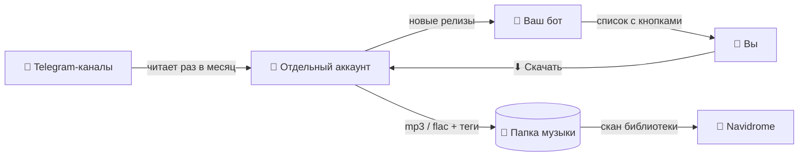

<div align="center">

# 🎧 tg-music-sync

**Музыка из Telegram-каналов — прямо в вашу библиотеку Navidrome.**

Раз в месяц бот присылает список новых релизов, вы нажимаете кнопку — треки уже в медиатеке.


</div>

---

## Содержание

- [Как это работает](#-как-это-работает)
- [Возможности](#-возможности)
- [Что понадобится](#-что-понадобится)
- [Установка](#-установка)
- [Настройки](#%EF%B8%8F-настройки)
- [Пользование ботом](#-пользование-ботом)
- [Теги и альбомы](#-теги-и-альбомы)
- [Безопасность](#-безопасность)
- [Решение проблем](#-решение-проблем)
- [FAQ](#-faq)

---

## 🔄 Как это работает



В одном контейнере работают два клиента Telegram:

| Кто | Что делает |
|---|---|
| **Отдельный аккаунт** | Подписан на каналы, читает историю и скачивает файлы любого размера. Обычный бот этого не умеет. |
| **Бот** | Пишет вам отчёт и принимает нажатия кнопок. Слушается только владельца. |

Navidrome ничего не нужно настраивать: он просто видит новые файлы в своей папке.

## ✨ Возможности

- 🗓 **Ежемесячная проверка** в заданный день и час; пропущенная проверка выполнится при запуске
- 💿 **Релизы, а не файлы** — альбом, выложенный одной пачкой, показывается одной строкой
- 🔘 **Выбор кнопками** — скачать один релиз, всё сразу или пропустить; листание длинных списков
- 📌 **Ничего не теряется** — неразобранные релизы приходят снова со следующим отчётом
- 🏷 **Аккуратные теги** — сборники, сплиты, синглы, единое написание исполнителей и один год на альбом: Navidrome не дробит альбомы
- 🛡 **Без открытых портов**, без root, файловая система контейнера только для чтения
- ♻️ **Без дублей** — уже скачанные файлы пропускаются; недокачанные не попадают в библиотеку
- ⏱ **Оценка времени** — объём и примерное время до начала скачивания и прогресс во время него
- ⏹ **Остановка в любой момент** — недокачанный файл удаляется, остальное сохраняется
- 🐢 **Бережно к Telegram** — паузы между файлами, лимит файлов за раз, честное ожидание FloodWait

## 📋 Что понадобится

- сервер с Docker Compose и работающим Navidrome
- **отдельный аккаунт Telegram** (нужен второй номер телефона), подписанный на каналы
- `API_ID` и `API_HASH` этого аккаунта — [my.telegram.org](https://my.telegram.org) → *API development tools*
- токен бота — [@BotFather](https://t.me/BotFather) → `/newbot`

> [!TIP]
> Перед подключением пару дней попользуйтесь новым аккаунтом вручную. Свежие аккаунты, которые сразу начинают работать автоматически, Telegram может ограничить.

## 🚀 Установка

**1. Получите файлы и создайте конфиг**

```bash
git clone <url-этого-репозитория> tg-music-sync
cd tg-music-sync
cp .env.example .env
nano .env
```

Заполните всё, кроме `OWNER_ID`. Путь `MUSIC_PATH` — та же папка хоста, что подключена в Navidrome
(смотрите `volumes` в его compose-файле).

**2. Подготовьте папку для данных**

```bash
mkdir -p data
sudo chown 1000:1000 data         # ваши PUID:PGID из .env
chmod 700 data && chmod 600 .env
```

**3. Войдите отдельным аккаунтом** (один раз)

```bash
docker compose build
docker compose run --rm tg-music-sync python sync.py --login
```

Введите номер отдельного аккаунта, код из Telegram и облачный пароль, если он включён.

**4. Запустите и привяжите бота к себе**

```bash
docker compose up -d
```

1. Со своего **основного** аккаунта напишите боту `/start` — он пришлёт ваш id.
2. Впишите его в `OWNER_ID` в `.env`.
3. Перезапустите и снова отправьте боту `/start`:

```bash
docker compose up -d --force-recreate
```

**5. Проверьте** — отправьте боту `/scan`.

## ⚙️ Настройки

Все параметры задаются в `.env`:

| Переменная | Описание | По умолчанию |
|---|---|---|
| `API_ID`, `API_HASH` | ключи отдельного аккаунта | — |
| `BOT_TOKEN` | токен бота | — |
| `OWNER_ID` | ваш id в Telegram; бот слушается только его | — |
| `CHANNELS` | каналы через запятую: `username`, `t.me/…` или `-100…` | — |
| `SCAN_DAY` | число месяца для проверки (1–28) | `1` |
| `SCAN_HOUR` | час проверки | `10` |
| `TZ` | часовой пояс | `UTC` |
| `MUSIC_PATH` | папка музыки на хосте | — |
| `MUSIC_DIR` | куда класть треки внутри контейнера | `/music/telegram` |
| `FIX_TAGS` | заполнять пустые теги | `true` |
| `AUTO_FIX_TAGS` | приводить теги в порядок после каждого скачивания | `true` |
| `DOWNLOAD_DELAY` | пауза между файлами, сек | `3` |
| `MAX_FILES_PER_RUN` | максимум файлов за одно нажатие | `200` |
| `PUID`, `PGID` | владелец файлов музыки | `1000` |

Треки раскладываются так:

```
<папка музыки>/
└── telegram/
    ├── Название канала 1/
    │   ├── Artist - Track.mp3
    │   └── …
    └── Название канала 2/
```

## 🤖 Пользование ботом

| Команда / кнопка | Действие |
|---|---|
| `/scan` | проверить каналы прямо сейчас |
| `/pending` | показать неразобранные релизы |
| `/stop` или `⏹ Остановить` | остановить скачивание |
| `⬇ 3` | скачать релиз №3 |
| `⬇ Скачать все` | скачать все релизы канала |
| `✖ Пропустить все` | отметить релизы канала как просмотренные |
| `◀` `▶` | листать список |

Пример отчёта:

```
🎵 Название канала — ждут решения: 3
Всего 10 файлов, 94 МБ · ≈ 2 мин

1. Artist — Album · 8 тр. (05.11, 74 МБ)
2. Artist — Single (12.11, 9 МБ)
3. Artist — Track (20.11, 11 МБ)

[ ⬇ 1 ] [ ⬇ 2 ] [ ⬇ 3 ]
[ ⬇ Скачать все (3) ] [ ✖ Пропустить все ]
```

Во время скачивания бот показывает прогресс и обновляет его каждые несколько секунд:

```
⬇ Название канала
Файлы: 25/200 · 230 МБ из 1.8 ГБ
Осталось ≈ 26 мин (скорость 1.1 МБ/с)
[ ⏹ Остановить ]
```

Оценка времени считается по реально измеренной скорости; до первого скачивания — приблизительная.

> [!NOTE]
> Первая проверка находит всю историю каналов. Если старое не нужно — нажмите «Пропустить все».

### Большие объёмы

- За одно нажатие качается не больше `MAX_FILES_PER_RUN` файлов — остальное остаётся в списке.
- Если Telegram просит подождать (FloodWait), бот сообщает об этом, выжидает паузу и продолжает сам.
- **Остановка безопасна:** текущий недокачанный файл удаляется, уже скачанные остаются,
  незавершённый релиз остаётся в списке и при повторе докачивается без дублей.
  Даже после `docker compose stop` посреди файла хвосты `.part` удаляются при следующем запуске.
- Файлы пишутся сразу в папку Navidrome — без временных копий.

## 🏷 Теги и альбомы

Navidrome собирает альбомы по тегам `album` + `albumartist` (и дате), а не по папкам.
Файлы из Telegram часто подписаны небрежно, поэтому один сборник превращается в десяток
одинаковых альбомов с одной обложкой. `tagfix.py` это исправляет:

| Ситуация | Что делает |
|---|---|
| Сборник (`Vol.`, `Teil`, `II`, … или больше 3 групп) | `albumartist = Various Artists` + флаг `compilation` |
| Сплит из 2–3 групп | `albumartist = "Группа A & Группа B"` |
| Одна группа, в т.ч. `X feat. Y` | `albumartist = X` |
| Альбом пустой, `single`, `#хэштег`, название канала, ссылка | сингл: альбом = название трека |
| `Группа` / `группа` / `Группа ` | одно, самое частое написание |
| Разные годы в одном альбоме | самый частый год |
| `2014 - Альбом`, `Группа By_XXXX` | `Альбом`, `Группа` |

После каждого скачивания это выполняется автоматически (`AUTO_FIX_TAGS`).
Для уже скачанной библиотеки:

```bash
# 1. посмотреть, что изменится (файлы не трогаются)
docker compose run --rm tg-music-sync python sync.py --fix-tags

# 2. применить — старые теги сохраняются в data/tags_backup_*.json
docker compose run --rm tg-music-sync python sync.py --fix-tags --apply

# откат
docker compose run --rm tg-music-sync python tagfix.py --undo /data/tags_backup_<дата>.json
```

Отчёт о проблемных тегах (только чтение):

```bash
docker compose run --rm -v "$PWD/tools:/tools:ro" tg-music-sync python /tools/tag_report.py
```

**Исключения.** Если правило ошиблось для конкретного альбома, скопируйте
`tag_overrides.example.json` в `data/tag_overrides.json` и укажите правильный вариант:

```json
{ "albums": { "Название альбома": { "albumartist": "Исполнитель" },
              "Название сборника": { "compilation": true } } }
```

После правки тегов запустите в Navidrome сканирование библиотеки.

## 🛡 Безопасность

**Что уже сделано**

- бот реагирует только на `OWNER_ID`, остальным отвечает «Нет доступа»
- через бота нельзя передать ссылку или путь — только выбор из найденного в ваших каналах
- соединение исходящее, порты на роутере открывать не нужно
- контейнер: не root, `read_only`, `cap_drop: ALL`, `no-new-privileges`, лимиты памяти и процессов

**Что сделать самому**

- [ ] включить облачный пароль на отдельном аккаунте
- [ ] в @BotFather: `/setjoingroups` → *Disable*
- [ ] `chmod 600 .env` и `chmod 700 data`
- [ ] не публиковать username бота

**Что нельзя публиковать**

| Файл | Почему |
|---|---|
| `.env` | ключи API и токен бота |
| `data/user.session` | готовый вход в аккаунт — без пароля и кода |
| `data/bot.session`, `data/state.json` | личные данные |

Всё это уже исключено в `.gitignore`.

**Если что-то утекло**

| Что | Что делать |
|---|---|
| `BOT_TOKEN` | @BotFather → `/revoke`, новый токен в `.env`, перезапуск |
| `user.session` | Настройки → Устройства → завершить сеанс, затем снова `--login` |
| `API_HASH` | удалить приложение на my.telegram.org и создать новое |

## 🧰 Решение проблем

| Сообщение в логах | Решение |
|---|---|
| `Нет сессии` | выполнить шаг 3 установки |
| `Permission denied` | проверить `PUID`/`PGID` и владельца `data/` и папки музыки |
| `Could not find the input entity` | написать боту `/start` с основного аккаунта |
| ошибка на канале | аккаунт не подписан на канал или неверный username |
| треков нет в Navidrome | у Navidrome должна быть та же папка; задать `ND_SCANSCHEDULE=@every 1h` |

Логи:

```bash
docker compose logs -f tg-music-sync
```

## ❓ FAQ

<details>
<summary><b>Navidrome сам объединит исполнителей и альбомы?</b></summary>

Да — по тегам внутри файлов, а не по папкам. Большинство проблем исправляет
`tagfix.py` (см. [Теги и альбомы](#-теги-и-альбомы)). Совсем перепутанные теги
удобнее поправить вручную в MusicBrainz Picard или Mp3tag.
</details>

<details>
<summary><b>В альбоме оказалась ссылка вида <code>[Канал](https://t.me/…)</code></b></summary>

Так подписывала треки старая версия. Исправляется вместе с остальными тегами:

```bash
docker compose run --rm tg-music-sync python sync.py --fix-tags --apply
```
</details>

<details>
<summary><b>Как перекачать канал заново?</b></summary>

Удалите запись канала из `data/state.json` и запустите `/scan`. Уже существующие файлы будут пропущены.
</details>

<details>
<summary><b>Можно ли проверять чаще, чем раз в месяц?</b></summary>

Плановая проверка — ежемесячная, но `/scan` можно отправить в любой момент.
</details>

<details>
<summary><b>Почему не обычный бот?</b></summary>

Бот не видит историю каналов, должен быть в них администратором и через Bot API
скачивает файлы только до 20 МБ. Отдельный аккаунт лишён этих ограничений.
</details>

---

<div align="center">
<sub>Используйте только с разрешения авторов каналов.</sub>
</div>
